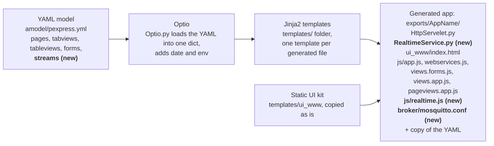
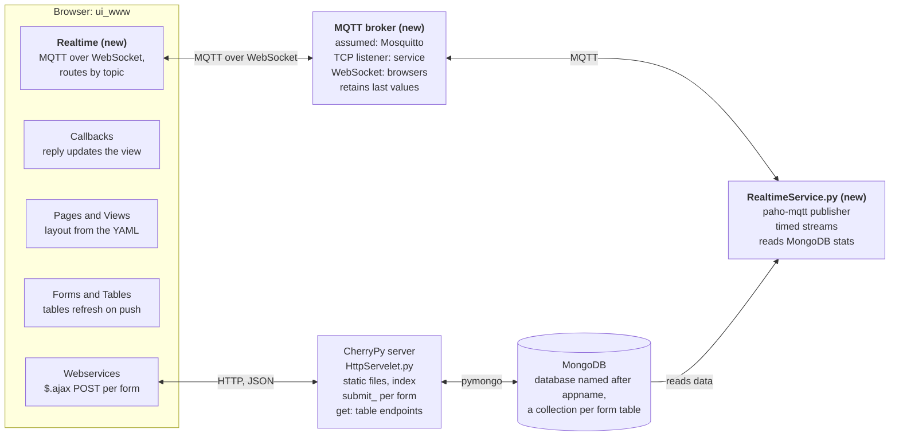
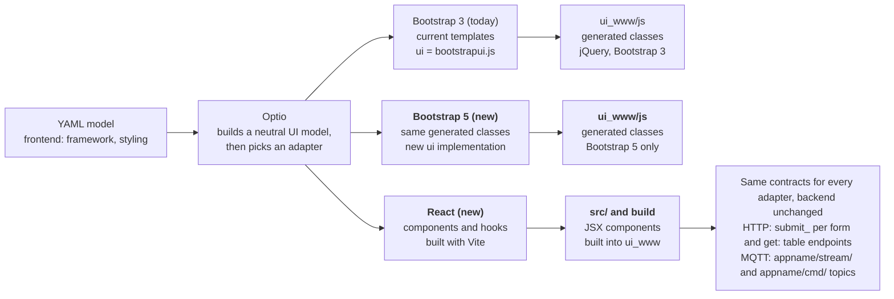
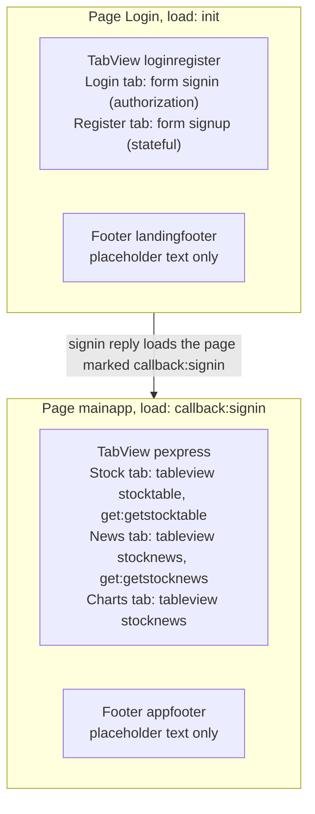

# Optio (neoWebUI) – Software Architecture

Source: https://github.com/neosinha/neoWebUI (branch `master`, last commit July 2023).

Optio is a model-to-app generator: a single YAML file declares pages, tabs, tables and forms, and `Optio.py` renders Jinja2 templates into a runnable web app (a CherryPy backend with MongoDB storage, and a jQuery/Bootstrap browser frontend). The YAML is the only hand-written input; everything else is generated.

This document covers the YAML path (`amodel/*.yml`, `Optio.py`, `templates/`). The Excel path (`Scaffolds.py`, `template_excel/`, `appmodel/*.xlsx`) is an older revision and is out of scope.

**Status of this revision:** it adds a *proposed* second backend service and an MQTT broker, so the frontend can be bound to the backend in real time (live statistics, telemetry). Everything marked **(new)** is a design for Optio and is not in the repository today. The existing HTTP request/reply service is unchanged. It also makes the frontend framework pluggable (Bootstrap 3, Bootstrap 5 or React).

---

## 1. Generation pipeline



The constructor loads the YAML into `backendmodel`, adds a date and the process environment, copies the static UI kit to the export folder, and keeps a copy of the YAML beside the output. The `generate*` methods then each build a context and render one template.

| Method | Template | Output |
|---|---|---|
| `generateFormSubmissions` | `httpServelet.template.py` | `HttpServelet.py` |
| `generateIndexFile` | `index.html` | `ui_www/index.html` |
| `generateAppService` | `app.template.js` | `ui_www/js/app.js` |
| `generateWebServices` | `webservices.template.js` | `ui_www/js/webservices.js` |
| `generateViews` | `views.forms.js`, `views.app.js`, `pageviews.app.js` | three files in `ui_www/js/` |
| `generateRealtimeService` **(new)** | `realtime.service.template.py` | `RealtimeService.py` |
| `generateRealtimeClient` **(new)** | `realtime.template.js`, `mosquitto.template.conf` | `ui_www/js/realtime.js`, `broker/mosquitto.conf` |

There is no intermediate model: the extract methods mostly return the YAML sections as they are, so the YAML structure is the model. Regenerating overwrites the output, so change the YAML, not the generated files.

## 2. The YAML model

| Key | Fields | Meaning |
|---|---|---|
| `appname` | string | Names the Mongo database and the log file. |
| `pages[]` | `page`, `load`, `subviews[]` | A screen. `load` is `init` (shown at startup) or `callback:<form>` (shown when that form's reply arrives). A subview is `tabview:<name>` or `footer:<name>`. |
| `tabviews[]` | `tabview`, `tabs[]` | A tab group. Each tab has a name and a `content` of `form:<name>` or `tableview:<name>`. |
| `tableviews[]` | `table`, `header`, `content` | A table. `header` is a comma-separated column list. `content: get:<api>` binds it to a backend endpoint. |
| `forms[]` | `form`, `table`, `recordtype`, `fields[]` | A form and its backend behaviour. Each field has `field`, `type` and `default`. |
| `streams[]` **(new)** | `stream`, `topic`, `source`, `interval`, `fields[]` | A real-time feed published over MQTT. A tableview binds to it with `content: live:<stream>` instead of `get:<api>`. |

| `frontend` **(new)** | `framework`, `styling` | Selects the frontend adapter: `bootstrap3` (default), `bootstrap5` or `react`. Omitting it keeps today's behaviour. |

The hierarchy is Page, then TabView, then Form or TableView, with Footer as a leaf. `appmodel/pexpress-backend.yml` sketches a future `apis:` section (name and params) that nothing reads yet.

## 3. Generated runtime



The two backend services meet only at MongoDB and the broker.

### Backend (HttpServelet.py)

One CherryPy `Webserver` class connects to MongoDB (default 127.0.0.1:27017) and uses a database named after `appname`. Each form gets a handle to its `table` collection, or to a collection named after the form. Forms that name the same table share a collection; `signin` and `signup` both use `authtable`. The command line takes port (default 9005), IP, Mongo address, static directory and log file. Sessions are on and the thread pool is 8.

| Record type | Behaviour of `submit_<form>` |
|---|---|
| `timeseries` | Inserts a timestamped document. Also generates a `qtable_<form>` query endpoint. |
| `stateful` | Upserts with `replace_one`, so a repeat submission updates the record. |
| `authorization` | Looks up the submitted field values with `find_one` and returns `{authorization: true or false}`. |

Each `get:` tableview becomes a GET endpoint named after the API. Today it returns generated sample rows built from the header columns.

### Frontend (ui_www)

The browser code is plain JavaScript with jQuery and Bootstrap 3. The static kit provides `bootstrapui.js`, a DOM builder exposed as the global `ui` (navbar, tabs, forms, tables). The generated classes are created as globals in `app.js`.

| Class | File | Role |
|---|---|---|
| `Pages` | `pageviews.app.js` | One `pageview_<page>()` per page. Builds the subviews and swaps them into `#mcontent`. |
| `Views` | `views.app.js` | One `gettabview_<tabview>()` per tab group. |
| `FormViews` | `views.forms.js` | `createview_<form>()` builds the form; `readform_<form>()` reads its values. |
| `TableViews` | `views.forms.js` | `create_<table>()` builds a table. |
| `Webservices` | `webservices.js` | One `$.ajax` POST per form to `/submit_<form>`, and one per `get:` table. |
| `Callbacks` | `webservices.js` | One handler per form. Stores the JSON in `backendmodel`, shows it, and loads any page whose `load` is `callback:<form>`. |
| `Realtime` **(new)** | `realtime.js` | MQTT client over WebSocket. Subscribes to the streams that views bind to and routes each message to the view's update function. |

On startup `index.html` calls `appInit()`, which loads the `init` page and then calls `getclientlog()`.

### Realtime service (MQTT, proposed)

The second backend service pushes data to the browser instead of the browser polling for it. CherryPy stays the request and reply service for forms and tables. A separate realtime process publishes telemetry and statistics to an MQTT broker, and the browser subscribes to the broker. The two services share no code path at runtime: they meet only at MongoDB (data) and the broker (events), so either can be restarted without the other.

| Component | Generated from | Role |
|---|---|---|
| MQTT broker | `mosquitto.template.conf` | Routes messages. A TCP listener serves the realtime service and a WebSocket listener serves browsers. Mosquitto is assumed; any MQTT broker with a WebSocket listener fits. |
| Realtime service | `RealtimeService.py` | A Python process using paho-mqtt. It reads each stream's source on its interval and publishes JSON. It also subscribes to command topics. |
| Browser client | `realtime.js` | The `Realtime` class. `appInit()` calls `realtime.connect()` beside `getclientlog()`. It subscribes to the topics of the streams that rendered views bind to. |

**Topics.** One naming convention, derived from `appname` and the stream name, in the same spirit as `submit_<form>`.

| Topic | Publisher | Subscriber | Payload |
|---|---|---|---|
| `appname/stream/<name>` | Realtime service | Browser | JSON with a timestamp and the stream's fields. |
| `appname/cmd/<name>` | Browser | Realtime service | JSON command or parameter change, such as a new interval. |
| `appname/status` | Realtime service | Browser | Online or offline, set as the MQTT last will so the UI can show a lost connection. |

**Model addition.** A new `streams` section declares each feed. A tableview then binds to it with `live:`.

```yaml
streams:
  - stream: "stockstats"
    topic: "stream/stockstats"
    source: "sample"
    interval: 2
    fields: ["TCKR", "Closing Price"]

tableviews:
  - table: "stocktable"
    header: "TCKR, Name, Closing Price"
    content: "live:stockstats"
```

`source` is `sample` (generated test data, like today's table getters) or `collection:<table>` (the latest documents or an aggregate from MongoDB). `interval` is in seconds.

**Data flow.**

1. The realtime service starts on its own, connects to the broker and MongoDB, and schedules each stream.
2. The browser opens a WebSocket to the broker at startup and subscribes to the topics its views bind to.
3. Each published message reaches `Realtime`, which routes it by topic to a generated `update_<table>()` on `TableViews` that refreshes the rows.
4. A command published on `appname/cmd/<name>` reaches the service, which applies it to the stream.

**Generator changes.** `Optio` gains `extractStreams()`, `generateRealtimeService()` and `generateRealtimeClient()`, and every context gets a `streams` key. `index.html` loads an MQTT client library and `realtime.js`. `app.template.js` creates the `Realtime` object and connects it. `views.forms.js` adds `update_<table>()`. The service takes broker and database addresses as command-line arguments, like the CherryPy server does.

**Assumptions to confirm.**

- Broker and client library: Mosquitto with a browser MQTT-over-WebSocket library.
- Delivery: QoS 0 for telemetry, QoS 1 for commands, and retained last values so a newly opened page shows data at once.
- Security is not defined. The current app has no authentication beyond the form check, so how the browser authenticates to the broker (and which topics it may write) is an open decision. A broker ACL that lets browsers read `stream/` and write only `cmd/` is the natural starting point.

### Pluggable frontend (proposed)

Today the generated frontend is tied to Bootstrap 3 and jQuery: templates emit calls to a global `ui` helper (`bootstrapui.js`), and form values are read back through DOM ids. This proposal makes the frontend framework a choice in the YAML, so the same model can generate a Bootstrap 3 app, a Bootstrap 5 app or a React app. The backend, the HTTP API and the MQTT topics are the same for every choice.



| Layer | Framework-neutral | Contents |
|---|---|---|
| UI model | Yes | Pages, tabviews, tableviews, forms, streams and the page flow, built once from the YAML and written as `ui-model.json`. |
| Contracts | Yes | The HTTP endpoints (`submit_<form>`, `get:` endpoints) and the MQTT topics. The backend already fixes these. |
| Adapter | No | The templates and static kit for one framework, chosen by `frontend.framework`. |

**Model addition.**

```yaml
frontend:
  framework: "react"      # bootstrap3 (default), bootstrap5 or react
  styling: "bootstrap5"   # CSS framework used by the react adapter
```

**Adapters.**

| Adapter | Output | How it renders |
|---|---|---|
| `bootstrap3` (today) | Generated classes in `ui_www/js/` | The existing templates and `bootstrapui.js`. |
| `bootstrap5` (new) | The same generated classes | A new `ui` implementation with the same methods (`navtabs`, `createForm`, `table`, and so on) on Bootstrap 5, without jQuery. The generated code does not change, so this is the smallest step. |
| `react` (new) | A Vite project: `src/App.jsx`, one component per page, tabview, form and table, `services/webservices.js`, `services/realtime.js` and `model/ui-model.json` | Pages are components driven by a `currentPage` state. Forms are controlled components keyed by form and field. `load: callback:<form>` becomes an effect on the reply. Live tables use a `useStream(topic)` hook. `npm run build` writes into `ui_www/`, so CherryPy serves it as static files exactly as it does today. |

Another Bootstrap-style or CSS framework is one more adapter folder: it only has to implement the adapter interface below.

**Generator changes.**

- `Optio` reads `frontend`, builds the UI model with `extractUiModel()`, and hands it to a `FrontendAdapter` (one subclass per framework) instead of calling the five frontend `generate*` methods itself. Backend generation (`generateFormSubmissions`, `generateRealtimeService`) is unchanged.
- Frontend templates move into `templates/frontends/<adapter>/`; backend templates stay in `templates/`. Each adapter carries its own static kit. The React adapter has none and ships `package.json` and `vite.config.js` instead, with a dev server that proxies to CherryPy on port 9005 and to the broker's WebSocket.
- Adapter interface: `generate(context, exportdir)` and the path of its static kit. Every adapter receives the same context.

**Refactoring needed first.**

| Coupling today | Change |
|---|---|
| Form values are read from DOM ids `<form>_<field>_id`. | Keep this as a detail of the Bootstrap adapters. React keeps form state in components. |
| Global singletons (`ui`, `forms`, `views`, `websx`, and so on). | The Bootstrap adapters keep them. React uses modules and hooks. |
| Templates emit HTML-building code inline. | Move the structure into the UI model. Templates only map it to framework calls. |
| The page flow is generated inside `Callbacks`. | Express it as data (`load: callback:<form>`) in the UI model, and let each adapter implement it its own way. |

**Assumptions to confirm.**

- React with Vite and JSX (not TypeScript).
- `styling` is Bootstrap 5, through React-Bootstrap or plain Bootstrap classes.
- The MQTT client library must work both as a plain script and in a bundled app; mqtt.js does.

## 4. Example: PExpress page flow



The `signin` form posts to `submit_signin`. When the reply arrives, the generated `Callbacks.signin` loads the `mainapp` page, which is the page whose `load` is `callback:signin`. The Login page is the `init` page, so it shows first.

## 5. Design principles

- The YAML is the single source of truth for schema, API, UI and navigation.
- Names are derived by convention: form `x` gives `submit_x`, `createview_x`, `Callbacks.x` and the DOM id `x_<field>_id`.
- `recordtype` is the extension point: a new backend behaviour is a new branch in one template.
- Generated files carry an overwrite warning, so regenerate rather than edit.

## 6. Known gaps

These come from reading the templates; the generator was not run.

| Area | Gap |
|---|---|
| Table views | The backend returns fake rows and the frontend renders placeholder data, so the real response is never shown. |
| Table AJAX | The generated call for `get:` tables uses `dataobj`, which is undefined there, and POSTs to what is a GET-style endpoint. |
| Tab loop | The `Webservices` loop over `tabviews.tabs` never produces output because `tabviews` is a list. |
| `stateful` reply | It returns a pymongo result object, which `json.dumps` cannot serialize. |
| `qtable_*` | It compares a stored date with a `timedelta`, so the filter is wrong. |
| Template typos | `{{dbanme}}`, and `formobj.name` and `fld.name` left over from the Excel schema. |
| `getclientlog` | The server requires a `clientlog` argument but the client sends none. |
| Passwords | The `authorization` type compares and stores them as plaintext. |
| App name | The backend uses the YAML `appname` (PExpressX); the JS templates use the constructor argument (PExpress). |
| Dependencies | `Optio.py` still imports pandas and numpy, which `requirements.txt` does not list and this path does not need. |
| Footers | A `footer:` subview renders only a placeholder. |
| Frontend coupling | Templates emit Bootstrap 3 and jQuery calls through the global `ui` helper and read form values by DOM id, so another framework needs the adapter split described under "Pluggable frontend" first. |

## 7. Repository map

| Path | Role |
|---|---|
| `amodel/pexpress.yml` | The model used by `Optio.__main__`. |
| `appmodel/pexpress.yml`, `pexpress-backend.yml`, `pexpress-compose.yaml` | Related model sketches. The backend file is a stub. |
| `Optio.py` | The generator. |
| `templates/` | Jinja2 sources, plus `ui_www/` copied as is. |
| `templates/realtime.service.template.py` **(new)** | Proposed template for the realtime service. |
| `templates/realtime.template.js`, `mosquitto.template.conf` **(new)** | Proposed templates for the browser client and the broker configuration. |
| `templates/frontends/<adapter>/` **(new)** | Proposed home for per-framework templates and static kits: `bootstrap3`, `bootstrap5`, `react`. |
| `WebServer.py` | A hand-written CherryPy skeleton the generated server was derived from. |
| `Scaffolds.py`, `template_excel/`, `appmodel/*.xlsx` | The older Excel-driven revision. |
| `main.py`, `WebUI.py` | Placeholders. |
